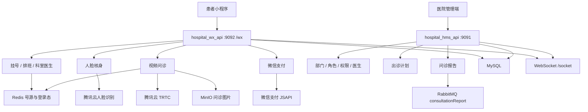
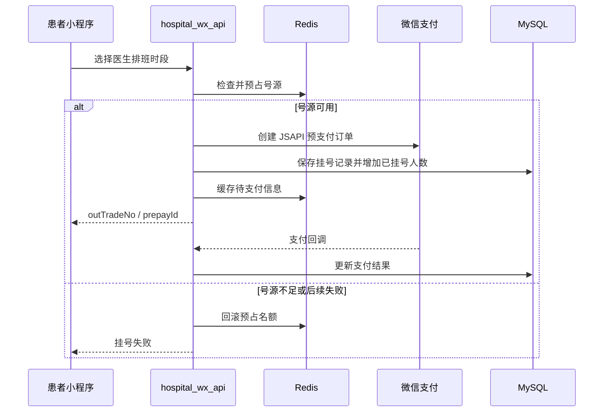

# 飞马智慧医院

面向患者小程序和医院管理端的门诊系统。患者可以查询科室与医生排班、占用号源并完成微信支付挂号；就诊前使用人脸核身，问诊时通过实时音视频进入诊室。管理端维护医院组织、医生、出诊计划和问诊报告。

技术栈：Java 15 · Spring Boot 2.5 · MyBatis · MySQL · Druid · Redis · Sa-Token · WebSocket · Quartz · RabbitMQ · MinIO · 微信支付 JSAPI · 腾讯云人脸识别 · 腾讯云实时音视频 TRTC

## 适合网申的项目描述

设计并实现医院管理端与患者小程序端分离的门诊后端。挂号时先用 Redis 预占医生时段号源，再创建微信支付预订单并写入挂号记录；支付或落库失败时回滚号源，避免超卖。问诊链路包含人脸核身、TRTC 房间凭证、在线医生列表、问诊图片和问诊报告。管理端通过 RabbitMQ 异步接收问诊报告并落库，WebSocket 维持会话在线状态。

## 核心亮点

- **号源先占后付，失败可回滚。** 挂号前检查 Redis 中的排班时段，成功占用名额后才创建微信预支付单、保存挂号记录并增加已挂号人数。异常时释放名额，避免支付失败仍占用号源。
- **排班按日期和时段组织。** 医生出诊计划拆成可预约时段，患者按科室、日期查看医生班次，管理端可以新增、调整和删除出诊计划。
- **挂号和视频问诊共用支付闭环。** 两条业务都生成商户订单号、预支付标识，并提供支付结果查询与微信回调入口。
- **就诊前增加人脸核身。** 使用腾讯云人脸识别创建人脸库并校验当日人脸，降低代挂号和非本人就诊风险。
- **视频问诊独立成链路。** 支持在线医生列表、上下线、TRTC `UserSig` 与房间号、问诊图片上传删除，以及问诊报告查询。
- **报告异步入库。** 管理端监听 `consultationReport` 队列，把诊断、处方和挂号关联信息写入问诊报告。
- **两端权限隔离。** `hospital_wx_api` 服务患者小程序，`hospital_hms_api` 服务医院员工；两端都使用 Sa-Token，登录信息缓存到 Redis。

## 系统架构



## 挂号支付



## 模块

| 模块 | 端口 | 职责 |
| --- | --- | --- |
| `hospital_wx_api` | 9092，上下文 `/wx` | 患者登录、就诊卡、科室医生、排班、挂号支付、人脸核身、视频问诊 |
| `hospital_hms_api` | 9091 | 员工账号、部门、角色权限、医生档案、出诊计划、视频问诊管理和问诊报告 |
| `common` | — | 两端共用的返回对象、异常和基础配置 |

## 主要能力

### 患者小程序

- 微信身份登录或注册，维护就诊人信息。
- 查询科室、子科室、医生和指定日期的出诊时段。
- 校验挂号条件、创建挂号单、重新支付并查询支付结果。
- 创建和校验人脸模型。
- 查看在线医生、生成 TRTC 用户签名和房间号，上传问诊图片。
- 按挂号记录查看问诊报告。

### 医院管理端

- 员工登录、修改密码，维护用户、部门、角色和权限。
- 维护医生档案、照片和所属诊室。
- 制定出诊计划，按诊室和日期调整或删除时段。
- 医生上下线、查看视频问诊订单和图片。
- 异步消费问诊报告消息并关联挂号单。

## 本地运行

依赖：JDK 15、Maven、MySQL、Redis。视频问诊和报告入库还需要 RabbitMQ、MinIO，以及微信支付、腾讯云人脸识别、TRTC 的有效配置。

```bash
mvn clean package -DskipTests
```

患者端入口是 `hospital_wx_api`，管理端入口是 `hospital_hms_api`。数据库、Redis、MinIO 和云服务密钥放在各自的 `application.yml` 中，仓库中的地址和口令应替换为本机配置，不要提交真实密钥。

患者端接口前缀示例：

```text
http://localhost:9092/wx/patient/registration/registerMedicalAppointment
http://localhost:9092/wx/video/diagnosis/createVideoDiagnoseOrder
http://localhost:9092/wx/face/auth/verifyFaceModel
```

开发环境开启了 SpringDoc，可在对应服务的 `/swagger-ui.html` 查看接口。

## 工程说明

父工程是 Maven 多模块，Java 版本为 15，Spring Boot 版本为 `2.5.2`。数据访问使用 MyBatis，连接池使用 Druid。

挂号金额在创建微信订单前会从元转换为分。排班时段使用 `slot` 编号映射具体时间，例如 1 对应 `08:00`。`MeetingWorkflowTask` 中保留了会议审批流程代码，但当前方法体处于注释状态，不作为已上线能力。
